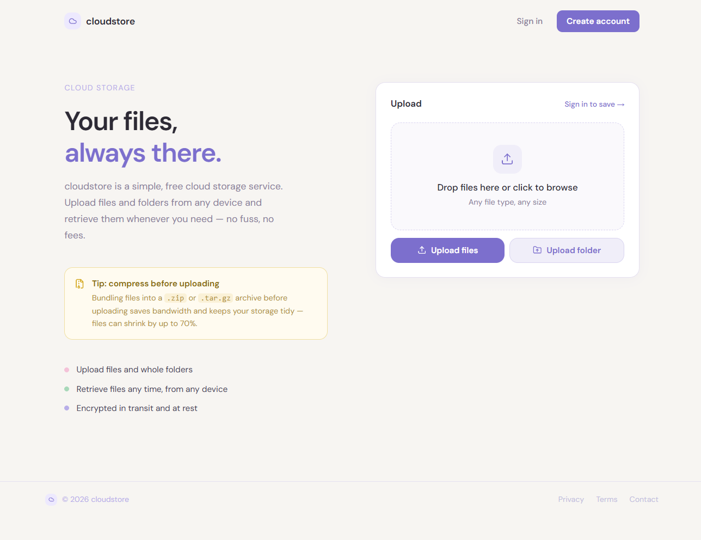

# CloudStore

A full-stack cloud file storage app built with React and TypeScript, running on a serverless AWS backend.

## Features

- **Secure accounts:** sign-up and sign-in with Amazon Cognito. A JWT authorizer protects every API request.
- **Per-user isolation:** each user's files sit under their own S3 prefix, so no one can reach another user's files.
- **Direct-to-S3 transfers:** uploads and downloads use presigned URLs, so file data doesn't pass through the API.
- **Storage tiers:** users can move rarely used files to S3 Glacier Instant Retrieval to lower storage cost.
- **File management:** drag-and-drop folder uploads, a nested folder tree, file search, and bulk download and delete.

## Tech Stack

| Layer    | Technology                     |
| -------- | ------------------------------ |
| Frontend | React, TypeScript              |
| API      | AWS API Gateway, AWS Lambda    |
| Auth     | Amazon Cognito (JWT authorizer)|
| Storage  | Amazon S3, S3 Glacier Instant Retrieval |

## Architecture

React client → API Gateway (Cognito JWT authorizer) → Lambda → S3 presigned URLs → client uploads and downloads directly to and from S3
